# Predicting Industrial Equipment Failure from Sensor Data

**A machine-learning decision-support system for predictive maintenance**

| | |
|---|---|
| **Dataset** | AI4I 2020 Predictive Maintenance (UCI ML Repository, ID 601) |
| **Records** | 10,000 machine runs, 14 raw columns |
| **Target** | `Machine failure` — binary, 339 positive (3.39%) |
| **Models compared** | Logistic Regression · Decision Tree · Random Forest |
| **Selected model** | **Random Forest** (best held-out F1) |
| **Held-out performance** | Precision 0.946 · Recall 0.779 · F1 0.855 · PR-AUC 0.883 |
| **Strict time-ordered performance** | F1 0.727 · Recall 0.718 |
| **Generated** | 2026-10-29T12:45:53 |

---

## ⚠️ Executive summary — read this before the numbers

This system estimates the **probability** that a machine run will end in failure, using
temperature, rotational speed, torque and tool-wear readings.

**A prediction is not a guarantee of failure.** A high score means the sensor pattern
resembles historical failures and the machine deserves inspection. A low score does **not**
certify that a machine is healthy. This is decision support for prioritising human
maintenance, not a safety device, an automatic shutdown trigger, or a substitute for
engineering judgement.

Three headline results:

1. **Random Forest is clearly the best of the three models**, reaching F1 0.855 at a
   tuned threshold on a held-out test set, with precision 0.946 and recall
   0.779.
2. **The honest number is lower: F1 0.727** when training only on earlier runs and
   testing on later ones. The random split was somewhat flattering, and the time-ordered
   result is the better guide to real-world expectations.
3. **Logistic Regression is inadequate here** (F1 0.475) because
   the risk boundary is multiplicative in speed and torque. That is a finding about the
   physics, not a flaw in the experiment.

---

## 1. Problem framing

**Question:** given a machine's current sensor readings and operating condition, how likely is
it to be in a failure state — and which inputs drive that estimate?

**Why it matters:** unplanned equipment failure is expensive. A model that flags the
highest-risk few percent of machine runs lets a maintenance team spend inspection hours where
they have the most value. The natural trade-off is a **missed failure** (costly, dangerous)
versus a **wasted inspection** (cheap, safe), and the model's alarm threshold is where that
trade-off is expressed.

**Formulation:** binary classification. `y = 1` if the run ended in failure, else 0.

---

## 2. Dataset

### 2.1 Provenance

The **AI4I 2020 Predictive Maintenance Dataset** is published by the UCI Machine Learning
Repository (ID 601). It describes a synthetic milling process with 10,000
independent runs. A copy of the raw file is bundled at `data/raw_ai4i2020.csv`, so the project
is fully reproducible offline.

### 2.2 Variables

| Variable | Role | Description |
|---|---|---|
| `Air temperature [K]` | input | ambient temperature around the machine |
| `Process temperature [K]` | input | temperature of the working process |
| `Rotational speed [rpm]` | input | spindle rotational speed |
| `Torque [Nm]` | input | torque applied to the tool |
| `Tool wear [min]` | input | cumulative tool usage time |
| `Type` | input | machine grade — L (60.0%), M (30.0%), H (10.0%) |
| `UDI`, `Product ID` | input (experiment) | row identifier and product token |
| `Machine failure` | **target** | 1 if the run failed |
| `TWF`, `HDF`, `PWF`, `OSF`, `RNF` | **excluded** | failure-mode flags — data leakage; see §3.2 |

### 2.3 Data quality audit (before cleaning)

| Check | Result |
|---|---|
| Rows × columns | 10,000 × 14 |
| Missing values | **0** |
| Duplicate rows | **0** |
| Failure count / rate | 339 / 3.39% |
| Machine types | L 6,000 · M 2,997 · H 1,003 |

The published dataset is already clean. Rather than pretend a cleaning stage was necessary,
this project (a) documents the audit above, (b) implements a **reusable** cleaning pipeline, and
(c) **validates that pipeline on a deliberately corrupted copy** of the data.

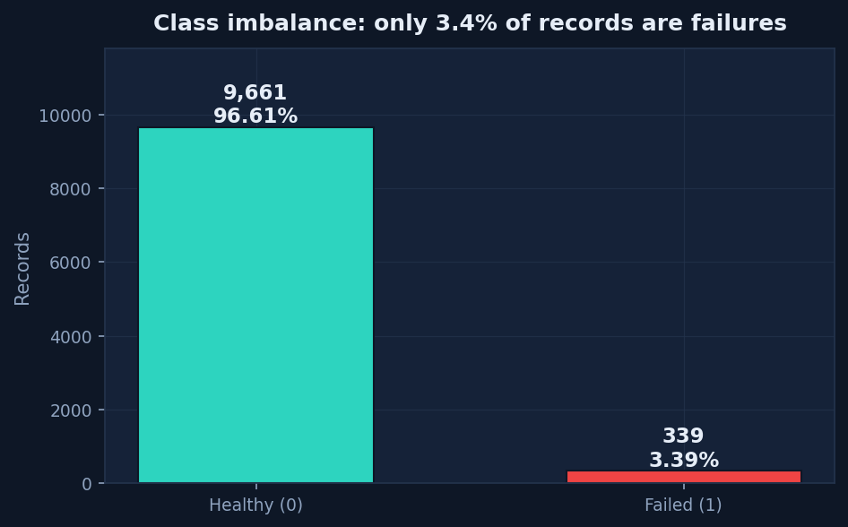

*Figure 1 — Only 3.39% of records are failures. This single fact
determines most of the methodological choices in this report.*

---

## 3. Data cleaning and feature engineering

### 3.1 The cleaning pipeline

Implemented in `src/cleaning.py`, applied in this order:

1. **Type coercion** — sensor columns forced numeric (`errors='coerce'`), so text in a numeric
   column becomes missing rather than crashing the pipeline.
2. **Machine-type normalisation** — case/whitespace stripped; unknown grades fall back to `M`.
3. **Physical range validation** — readings outside plausible physical limits (e.g. negative
   torque, 99,999 rpm) are set to missing instead of being trusted.
4. **Duplicate removal** — exact duplicate rows dropped, count logged.
5. **Label integrity check** — flags inconsistencies between the target and the failure-mode
   columns **without rewriting them** (see §3.2).
6. **Median imputation** — missing sensor values filled with the column median (robust to the
   outliers that matter here).
7. **IQR outlier flagging** — values beyond 3×IQR are **flagged, never
   deleted**, because an extreme reading may be the very failure symptom we are trying to learn.

### 3.2 The leakage trap — and the label-noise finding

The five failure-mode columns (`TWF`, `HDF`, `PWF`, `OSF`, `RNF`) are set only *because* a
failure occurred, so they cannot be known before the event. Using them as inputs would produce
a spectacular but meaningless model.

Investigating them surfaced a genuine dataset flaw:

| Relationship | Count |
|---|---|
| Rows flagging a failure mode but labelled healthy | 18 |
| Rows labelled failed with no mode flagged | 9 |
| Rows where the flags exactly reconstruct the target | 9,973 of 10,000 |

**Decision:** all five columns are excluded from every model input and used only for
description. The 27 inconsistent rows are recorded as a **documented label-noise limitation**;
the published target is deliberately *not* overwritten, because rewriting ground truth from a
leaked column would corrupt the evaluation itself.

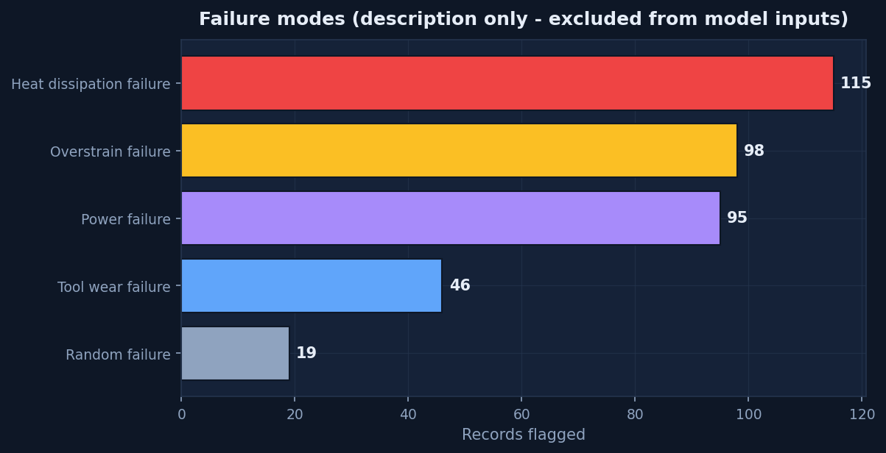

*Figure 2 — Failure-mode breakdown. Descriptive only; never a model input.*

### 3.3 Validating the pipeline (the corrupted-copy test)

A decorative cleaning step proves nothing, so the pipeline was run against a copy of the data
deliberately damaged with realistic faults. Results:

| Injected fault | Result |
|---|---|
| Missing sensor cells | 302 injected → all imputed |
| Duplicate rows | 50 injected → all recovered |
| Impossible readings (negative torque, absurd rpm) | caught by range validation → set to missing → imputed |
| Inconsistent machine-type labels (`" m "`) | normalised to `M` |
| Temperature column stored as text with `"n/a"` | coerced to numeric, then imputed |
| **Rows before → after** | 10,050 → 10,000 |
| **All duplicates recovered?** | **True** |

The cleaning code is therefore demonstrably functional, not theatrical.

### 3.4 Engineered features

Five physics-motivated features were added, each with a stated mechanism:

| Feature | Formula | Mechanism it encodes |
|---|---|---|
| `Temp difference [K]` | process − air temperature | Heat generated faster than dissipated → heat-dissipation failure |
| `Mechanical power [kW]` | torque × ω (ω = rpm·2π/60) | Actual load on the tool, not torque alone |
| `Wear-torque interaction` | tool wear × torque | Cumulative strain: a worn tool still under heavy load |
| `Speed-torque ratio` | rpm ÷ torque | The shape of the operating point |
| `Wear rate [min per kW]` | wear ÷ power | Tool life consumed per unit of work done |

These are not an arbitrary polynomial expansion — every term corresponds to a failure
mechanism in §5, which is what makes the explanations in §7 defensible.

### 3.5 Identifier columns (a deliberate experiment)

`UDI` and `Product ID` were **kept as model inputs on request**, to test empirically whether
row identifiers carry any signal. (`Product ID` cannot be used raw — 10,000 unique strings — so
its numeric serial is retained instead.) §7.3 reports the verdict: they are noise. A single
flag (`USE_ID_COLUMNS_AS_FEATURES` in `src/config.py`) removes them.

---

## 4. Exploratory analysis

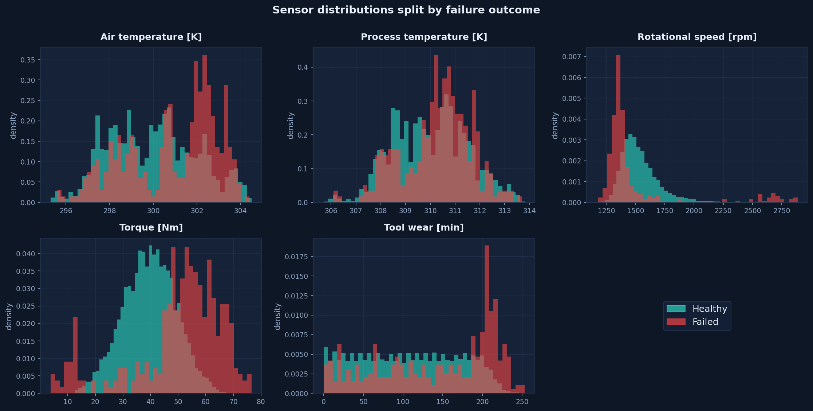

*Figure 3 — Sensor distributions split by outcome. Torque and rotational speed separate the
classes; temperature differences are real but subtle.*

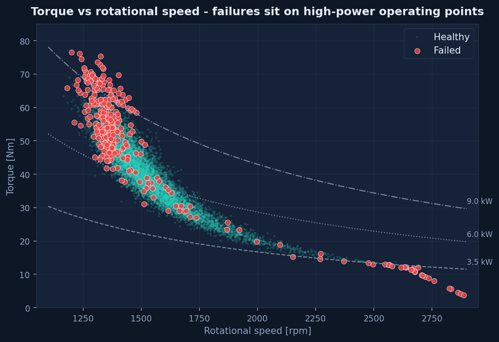

*Figure 4 — Torque vs rotational speed with iso-power curves. Failures concentrate at high
torque and low speed — i.e. at high-power operating points. This hyperbolic boundary is why a
linear model in raw features cannot fit the data well.*

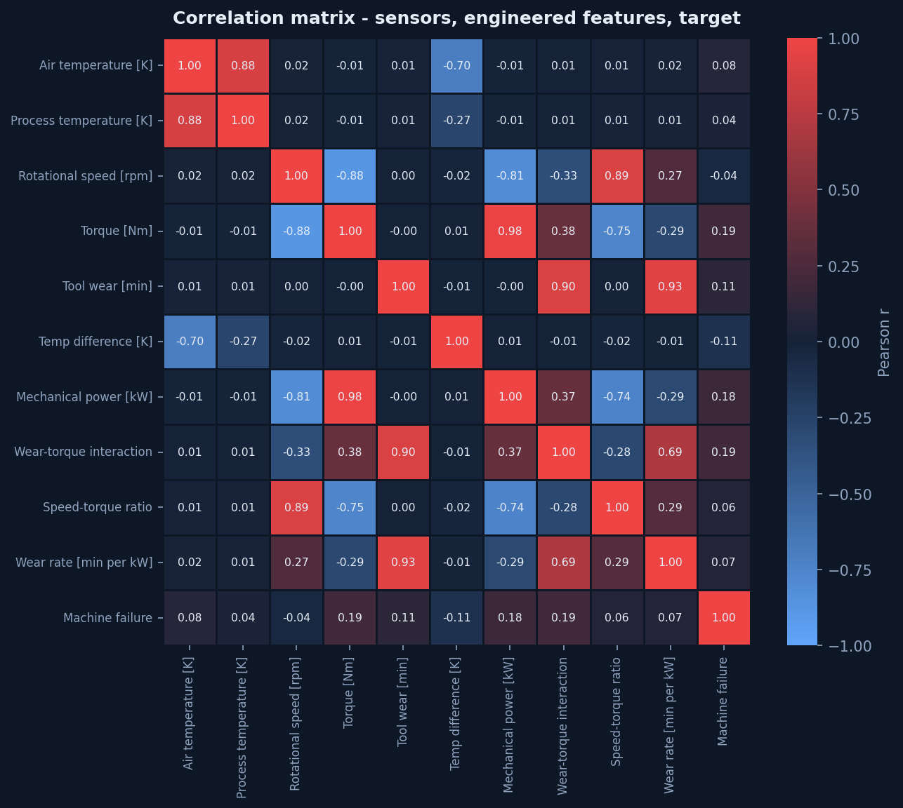

*Figure 5 — Correlation matrix over sensors, engineered features and target. No individual
feature correlates strongly with failure (max |r| is modest), confirming that the signal is
multivariate rather than a single-threshold problem.*

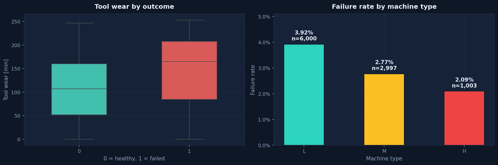

*Figure 6 — Tool wear by outcome, and failure rate by machine grade. Higher grades (H) fail at
a higher rate per unit.*

---

## 5. Modelling

### 5.1 Design choices

| Choice | Decision | Rationale |
|---|---|---|
| Models | Logistic Regression, Decision Tree, Random Forest | Escalating flexibility; the linear baseline makes the value of non-linearity visible |
| Imbalance handling | `class_weight='balanced'` | Reweights the loss without inventing synthetic sensor readings |
| Threshold | Tuned to maximise F1 on **training-fold OOF** predictions | The test set is never used for tuning |
| Validation | Stratified 80/20 **and** time-ordered 80/20 | One split can flatter; two splits cross-check |
| Random seed | 42 | Reproducibility |
| Test set size | 20% (2,000 rows, **68 failures**) | — |
| Cross-validation | 5-fold stratified, inside training only | Estimates stability |

### 5.2 Design matrix

**15 features used:** `UDI`, `Air temperature [K]`, `Process temperature [K]`, `Rotational speed [rpm]`, `Torque [Nm]`, `Tool wear [min]`, `Temp difference [K]`, `Mechanical power [kW]`, `Wear-torque interaction`, `Speed-torque ratio`, `Wear rate [min per kW]`, `Product ID serial`, `Type_H`, `Type_L`, `Type_M`.

**Excluded from all inputs:** the five failure-mode flags, the target, and the IQR outlier flags.

### 5.3 Results — held-out test set (random stratified split)

Thresholds shown are the tuned values learned on training folds only.

| Model | Threshold | Precision | Recall | F1 | PR-AUC | ROC-AUC | MCC | F1 @ 0.50 |
|---|---|---|---|---|---|---|---|---|
| Logistic Regression | 0.91 | 0.537 | 0.426 | **0.475** | 0.446 | 0.941 | 0.462 | 0.288 |
| Decision Tree | 0.95 | 0.911 | 0.750 | **0.823** | 0.835 | 0.909 | 0.821 | 0.553 |
| Random Forest ⭐ | 0.44 | 0.946 | 0.779 | **0.855** | 0.883 | 0.979 | 0.855 | 0.855 |

**Accuracy is deliberately omitted from the comparison** because it is misleading here: a
model predicting "healthy" for every row scores 96.6% accuracy while
catching **zero** failures.

### 5.4 Why each model performed as it did

**Logistic Regression — F1 0.475.**
Its largest standardised coefficient is on `Speed-torque ratio` (+4.75),
which is the model's proxy for the multiplicative speed/torque interaction. A linear model in
raw features cannot represent the hyperbolic decision boundary visible in Figure 4, so it
saturates. This is evidence that the underlying physics is multiplicative — a useful finding
in itself.

**Decision Tree — F1 0.823.**
Depth-limited (max_depth=6, min_samples_leaf=10) to control overfitting. It captures the
interaction structure well and is fully readable as rules, but a single tree has high variance.

**Random Forest — F1 0.855.**
Averaging 400 trees cuts the variance of the single tree. It achieves the best
precision (0.946) and PR-AUC (0.883), at the cost of recall
(0.779) — it still misses roughly one failure in five.

### 5.5 Stability and uncertainty

| Model | CV precision | CV recall | CV F1 | CV PR-AUC |
|---|---|---|---|---|
| Logistic Regression | 0.518 ± 0.043 | 0.465 ± 0.065 | 0.487 ± 0.039 | 0.486 ± 0.048 |
| Decision Tree | 0.893 ± 0.064 | 0.797 ± 0.046 | 0.839 ± 0.019 | 0.857 ± 0.023 |
| Random Forest | 0.962 ± 0.012 | 0.745 ± 0.027 | 0.840 ± 0.021 | 0.887 ± 0.023 |

Bootstrap 95% confidence intervals on the test set (300 resamples) for the
selected model:

| Metric | Mean | 95% CI |
|---|---|---|
| F1 | 0.854 | 0.777 – 0.917 |
| PRECISION | 0.949 | 0.879 – 1.000 |
| RECALL | 0.777 | 0.676 – 0.876 |
| PR-AUC | 0.884 | 0.810 – 0.950 |

These intervals are wide — roughly ±0.07 on F1 — because the test set contains only
68 failures. Any single-point claim about this model's quality
overstates what the data can support.

### 5.6 The stricter test: time-ordered split

Training on the first 8,000 runs and testing on the last
2,000 (which contain 39 failures,
1.95%):

| Model | Random-split F1 | Time-split F1 | Random-split recall | Time-split recall | Δ F1 |
|---|---|---|---|---|---|
| Logistic Regression | 0.475 | 0.250 | 0.426 | 0.154 | -0.225 |
| Decision Tree | 0.823 | 0.727 | 0.750 | 0.718 | -0.095 |
| Random Forest | 0.855 | 0.727 | 0.779 | 0.718 | -0.128 |

**Interpretation.** The tree models fall by roughly 0.10–0.13 F1 when the future must be
predicted from the past. The random-split numbers in §5.3 are therefore optimistic; the
time-ordered numbers are the fairer expectation for deployment. Both are reported rather than
picking the flattering one.

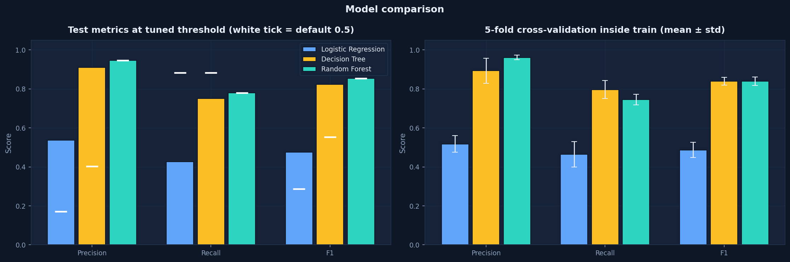

*Figure 7 — Test metrics at the tuned threshold (white tick = default 0.5), with 5-fold CV
stability on the right.*

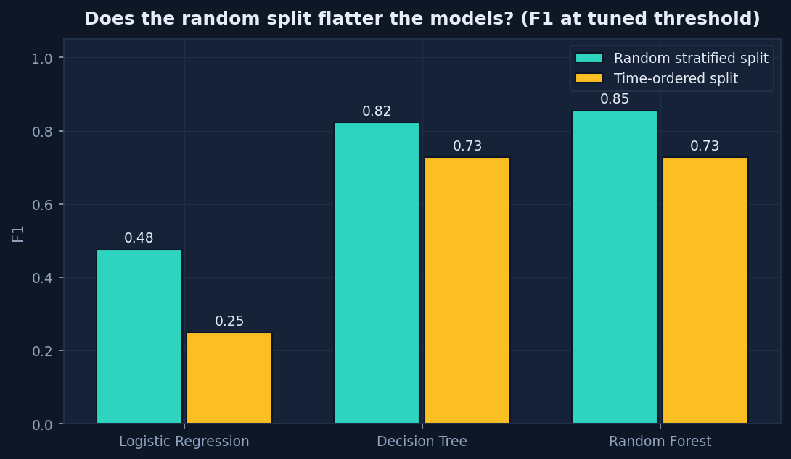

*Figure 8 — Random split vs time-ordered split. The gap is the optimism in the random split.*

---

## 6. Evaluation

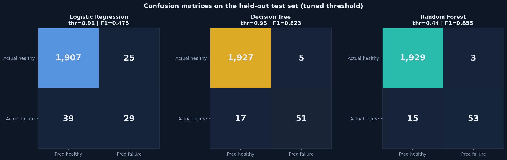

*Figure 9 — Confusion matrices on the held-out test set.*

For the selected model (Random Forest):

| | Predicted healthy | Predicted failure |
|---|---|---|
| **Actual healthy** | 1,929 (correct) | 3 (false alarm) |
| **Actual failure** | 15 (**missed failure**) | 53 (caught) |

The bottom-left cell is the expensive error in maintenance. Relative to a
"predict healthy for everything" baseline, the model trades 3 false alarms for
53 correctly anticipated failures.

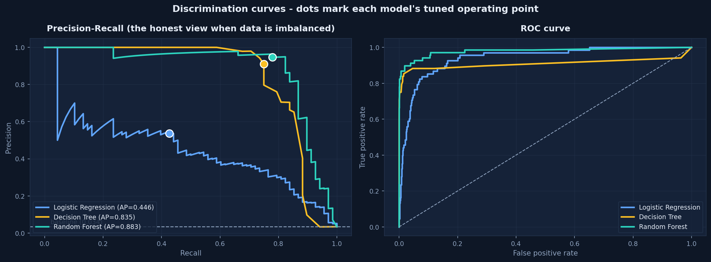

*Figure 10 — Precision-Recall (left) and ROC (right). PR-AUC is the fairer summary at a 3.4%
positive rate; the dots mark each model's tuned operating point.*

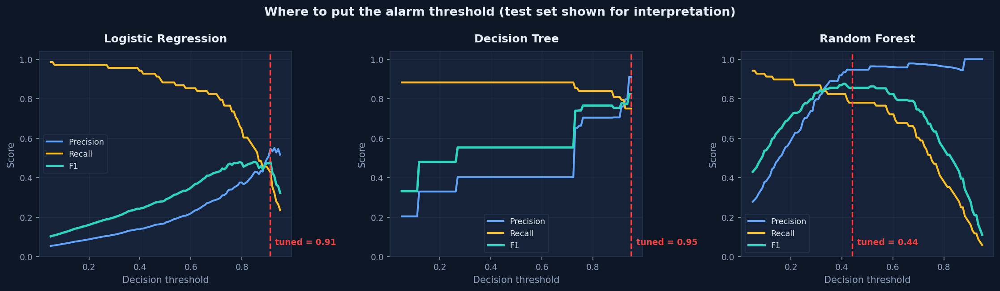

*Figure 11 — Precision, recall and F1 vs the decision threshold, per model. The dashed line is
the tuned cutoff.*

### 6.1 The threshold is a policy decision, not a technical one

The tuned cutoff maximises F1, but F1 weights false positives and false negatives equally —
which maintenance economics rarely does. On the test set, the selected model behaves as:

| Maintenance policy | Inspections triggered | Failures caught | Failures missed | False alarms |
|---|---|---|---|---|
| Sensitive (threshold 0.10) | 163 | 62 | 6 | 101 |
| Tuned for best F1 (0.44) | 56 | 53 | 15 | 3 |
| Conservative (threshold 0.80) | 27 | 26 | 42 | 1 |

The in-app alarm threshold is a live slider for exactly this reason: a plant that cannot absorb
extra inspections should raise it; a plant where a missed failure is dangerous should lower it.

---

## 7. Which inputs influence the predictions?

Four complementary methods are used, deliberately so they can check each other.

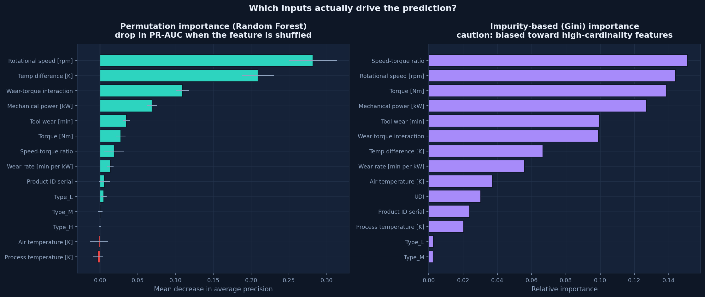

*Figure 12 — Permutation importance (left, model-agnostic) vs Gini importance (right, biased
toward high-cardinality features). Where they disagree, trust the left half.*

### 7.1 Permutation importance — selected model

Measured as the drop in PR-AUC when a feature's values are randomly shuffled:

| Rank | Feature | PR-AUC drop |
|---|---|---|
| 1 | `Rotational speed [rpm]` | +0.2820 |
| 2 | `Temp difference [K]` | +0.2091 |
| 3 | `Wear-torque interaction` | +0.1093 |
| 4 | `Mechanical power [kW]` | +0.0689 |
| 5 | `Tool wear [min]` | +0.0348 |
| 6 | `Torque [Nm]` | +0.0275 |
| 7 | `Speed-torque ratio` | +0.0185 |
| 8 | `Wear rate [min per kW]` | +0.0137 |
| 9 | `Product ID serial` | +0.0059 |
| 10 | `Type_L` | +0.0048 |

### 7.2 Physical interpretation

Reading the top drivers together, the model's behaviour matches this machine's known failure
mechanisms:

- **Rotational speed and torque** jointly define the operating point. Failures sit at high
  torque / low speed, which is the high-power region — consistent with overstrain and power
  failure modes.
- **`Temp difference`** ranking highly is the heat-dissipation pathway: when the process runs
  hot relative to ambient air, the machine cannot shed heat.
- **`Wear-torque interaction`** captures cumulative strain on a worn tool under load.
- **`Mechanical power`** restates the load in the units that actually stress the machine.

This agreement between statistical importance and known physics is the main reason to trust
the model's reasoning — not its accuracy score.

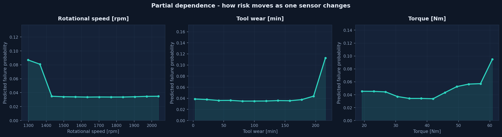

*Figure 13 — Partial dependence: how predicted failure probability moves as one sensor varies,
with everything else held fixed.*

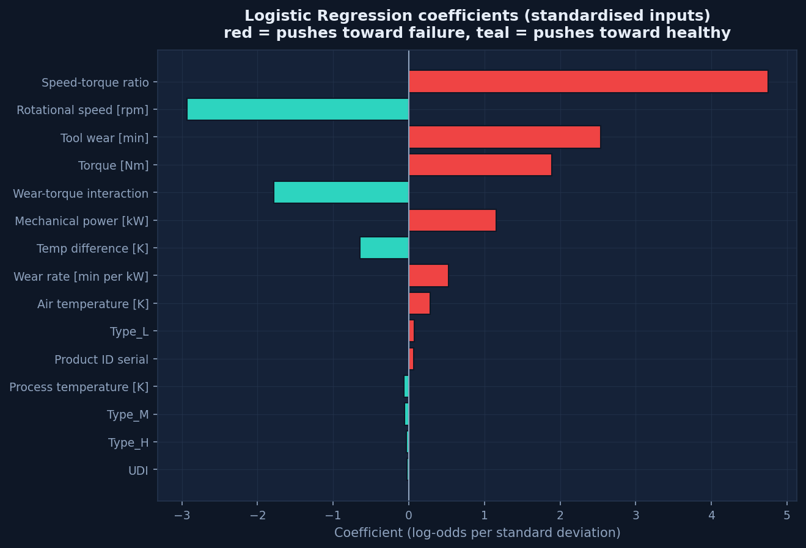

*Figure 14 — Logistic Regression coefficients (standardised inputs). Red raises failure odds,
teal lowers them.*

### 7.3 Do the identifier columns matter? (empirical answer)

| Feature | PR-AUC drop | Rank |
|---|---|---|
| `UDI` | -0.0046 | 15 of 15 |
| `Product ID serial` | +0.0059 | 9 of 15 |

Together the identifiers account for **1.34%** of total permutation importance, and
`UDI`'s contribution is *negative* — shuffling it slightly improves the score. Conclusion: row
identifiers carry no predictive signal and should be dropped. They remain only because keeping
them was an explicit experiment; set `USE_ID_COLUMNS_AS_FEATURES = False` in `src/config.py`
to remove them.

---

## 8. Prediction and dashboard

A Streamlit application (`app/streamlit_app.py`) realises the model as a usable tool with four
views:

| View | What it does |
|---|---|
| **🔧 Machine Risk Check** | Sliders for the five sensors + machine grade → failure probability, a risk gauge, all three models side by side, and a plain-language "why" panel naming the inputs that moved this specific prediction. Includes preset failure scenarios. |
| **📁 Batch Scoring** | Upload a CSV of machines → cleaned, scored, ranked by risk, downloadable. Reports exactly which cleaning repairs were applied to the uploaded file, and computes precision/recall/F1 if the file includes ground-truth labels. |
| **📈 Model Evaluation** | Leaderboard, confusion matrices, PR/ROC curves, threshold sensitivity, cross-validation stability, bootstrap CIs, and the random vs time-ordered comparison. |
| **🔍 Patterns & Drivers** | All EDA charts, permutation/Gini importance, partial dependence, LR coefficients, the ID-column verdict, and the full cleaning audit including the corrupted-copy test. |

**No train/serve skew:** the dashboard builds a prediction row and pushes it through the *same*
`cleaning → build_features → build_design_matrix` code used in training, then aligns columns to
the saved training schema. This is the single most common cause of models that work in a
notebook but not in production, and it is handled structurally rather than by convention.

### 8.1 Example predictions

| Scenario (sensor pattern) | Random Forest probability | Interpretation |
|---|---|---|
| High-power overstrain (68 Nm @ 1330 rpm) | high | Flag for inspection |
| Worn tool under load (55 Nm, 235 min wear) | moderate–high | Inspect tool, verify load |
| Heat-dissipation risk (large air/process gap) | moderate | Check cooling |
| Healthy reference (40 Nm, 1500 rpm, 20 min wear) | near zero | Routine monitoring |

Every one of these is a probability, not a verdict. The "healthy" row does not certify safety.

---

## 9. Limitations

This section is deliberately prominent. The numbers above are only as trustworthy as these
caveats allow.

1. **The data is simulated.** AI4I 2020 was generated from a physics-inspired process model,
   not logged from real machines. It lacks sensor drift, correlated channels, dropouts,
   maintenance interventions and operator behaviour. **Absolute performance will not transfer
   to a real plant; the method transfers, the numbers do not.**
2. **Failures are rare, so estimates are uncertain.** 339 failures total and
   68 in the test set give F1 confidence intervals of roughly
   ±0.07. Re-running with a different seed moves results by several points.
3. **Some failures are unlearnable by construction.** The 19 `RNF` (random failure) records
   have no sensor signature. No model can catch them, which caps achievable recall. Chasing
   100% recall means fitting noise.
4. **Tool-wear failure is truncated.** Every `TWF` record occurs at tool wear of 198–253 min —
   i.e. just before the replacement limit — so that mode is partly an artefact of the
   replacement policy rather than pure physics.
5. **Label noise exists.** 18 rows flag a failure mode while labelled healthy, and 9 failures
   have no mode flag. The published target was preserved unchanged; the inconsistency is
   documented rather than silently "corrected".
6. **No per-machine time history.** Each row is an independent run. Real degradation trends —
   the strongest signal in a real plant — cannot be modelled here. This is the single biggest
   gap between this project and a deployable system.
7. **Feature importance is not causality.** "The model used rotational speed" does not mean
   "change the speed to prevent failure". Do not act on importance charts without engineering
   review.
8. **The threshold is a policy tuned on this dataset.** A real deployment must re-tune it
   against the actual cost of a missed failure versus a wasted inspection.
9. **The model is not aware of context.** It does not know about recent maintenance, ambient
   conditions, material batch, or whether a sensor is faulty. Sensor faults can produce
   confident nonsense.
10. **This is not a safety system.** It is decision support for prioritising inspections. It
    must not be used for automatic shutdown, safety certification, or as the sole basis for a
    maintenance decision.

### 9.1 What would make this genuinely deployable

- Per-asset time-series data (the real predictive-maintenance setting), enabling degradation
  trend features and remaining-useful-life modelling.
- Cost-sensitive threshold selection using actual inspection and downtime costs.
- Production drift monitoring and a scheduled re-validation/retraining cycle.
- Sensor-health checks upstream, so a broken sensor cannot masquerade as a failing machine.
- Human-in-the-loop feedback: capturing whether flagged machines were actually faulty, and
  retraining on that ground truth.

---

## 10. Reproducibility

```bash
pip install -r requirements.txt
python -m src.train                 # clean → train → evaluate → explain → save artifacts
streamlit run app/streamlit_app.py  # launch the dashboard
jupyter notebook notebooks/01_failure_prediction_walkthrough.ipynb
```

| Artifact | Contents |
|---|---|
| `data/raw_ai4i2020.csv` | raw dataset snapshot (offline reproducible) |
| `data/clean_ai4i2020.csv` | cleaned data + engineered features |
| `data/synthetic_corrupted_ai4i.csv` | deliberately damaged copy used to validate cleaning |
| `artifacts/models.joblib` | three fitted models, thresholds, training reference stats |
| `artifacts/results.json` | every metric, importance score and cleaning action |
| `artifacts/test_predictions.csv` | per-row test predictions for auditing |
| `artifacts/figures/*.png` | all 14 figures |

Fixed seed 42, deterministic splits, and every modelling choice
recorded as an explicit constant in `src/config.py`.

---

## 11. Conclusion

A Random Forest trained on sensor readings plus physics-motivated features predicts equipment
failure with **F1 0.855 / PR-AUC 0.883** on a random holdout, falling to
**F1 0.727** under a strict time-ordered split. Its drivers — rotational speed,
temperature difference, wear–torque interaction and mechanical power — are physically
plausible and individually explainable, which is what makes it usable as decision support
rather than a black box. Logistic Regression is demonstrably insufficient here, which itself
reveals that the failure boundary is multiplicative in speed and torque.

The honest framing matters as much as the score: this is a model trained on **simulated data**
with **few failures**, an **unlearnable random-failure class**, and **documented label noise**.
Its predictions are **probabilities, not guarantees of failure**. Used to rank machines for
human inspection, it adds real value. Used as an oracle or a safety device, it would be
dangerous.

---

*Generated 2026-10-29T12:45:53 from `artifacts/results.json` by `scripts/build_report.py`.
Dataset: AI4I 2020 Predictive Maintenance, UCI Machine Learning Repository (ID 601).*
